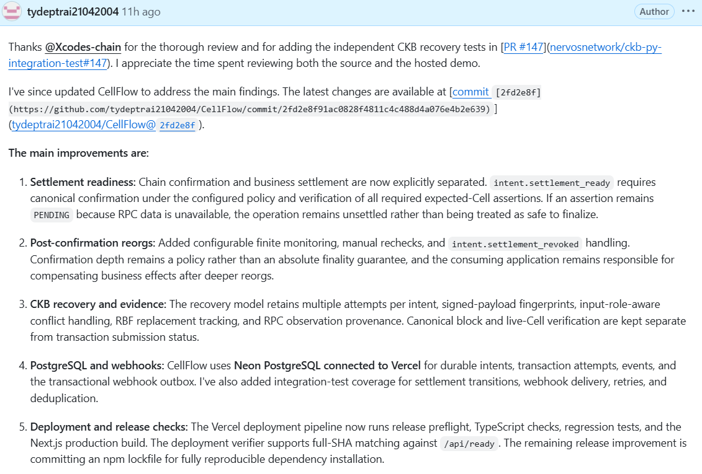
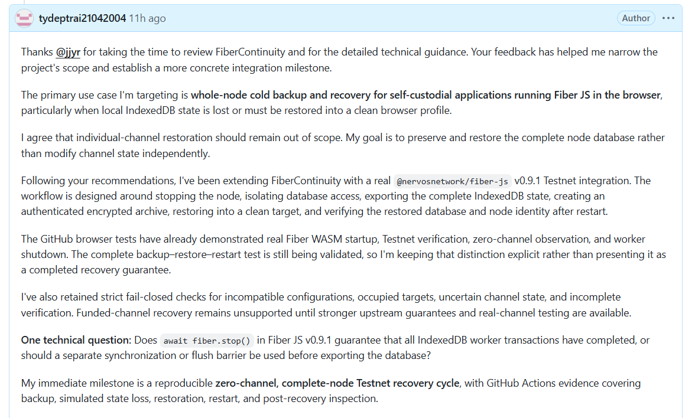

# Week 14 Report — Reviewer-Led Safety Hardening and Builder-to-Builder Technical Review

**Builder:** Dang Ba Ty  
**Track:** Community Keeps Building — Builders  
**Week:** 14  
**Date:** 15 October 2026  
**Repository:** https://github.com/tydeptrai21042004/ckb-skill  
**Previous report:** [Week 13](./week-13-report.md)

## 1. Summary

Week 14 continued the feedback-first direction from Week 13. I concentrated on fixing concrete CKB and Fiber safety problems reported by experienced builders, rather than adding new project concepts. Three streams progressed: **CellFlow** received changes responding to an independent source-level review of premature settlement and deep reorg behavior; **FiberContinuity** narrowed its integration goal to cold, complete-node IndexedDB recovery using Fiber JS; and **CellGuard** added a campaign-capacity-preservation policy and synthetic regression based on a historical CrowdCell finalize bug. I also contributed source-level technical feedback to another CKBuilder, **Tùng Lương Thanh**, on `ckb-session-kit` and `ckb-cycle-tools`.

This report distinguishes **implemented functionality**, **local regression coverage**, **author-reported Testnet execution**, and **remaining end-to-end evidence**. The two screenshots show my posted follow-ups to CellFlow and FiberContinuity reviewers; they are not substitutes for transaction receipts or browser recovery logs.

## 2. Week 13 → Week 14 progress

| Area | Week 13 position | Week 14 work and evidence boundary |
|---|---|---|
| CellFlow | More mature contention recovery; publish retained real-Testnet evidence | Addressed `Xcodes-chain` findings: separate `intent.settlement_ready`, finite post-confirmation monitoring, explicit recheck and `intent.settlement_revoked`, DB/webhook test paths, and deployed-SHA verification tooling. Previous author-reported Testnet RBF/lost-response tests remain distinct from the local demo. |
| FiberContinuity | CKBuilder issue #41 filed; browser recovery demo simulated | Incorporated `jjyr` guidance: full-node, zero-channel cold recovery; stop-and-isolate IndexedDB; encrypted archive, target checks, restart verification and real Fiber JS v0.9.1 integration work. Complete hosted backup–restore–restart evidence still pending. |
| CellGuard | Browser preflight and synthetic policy demonstration | Responded to Rick's real CrowdCell review: capacity-flow and dependency policies, historical committed-tx audit behavior, and a typed-campaign preservation invariant with a 474 CKB synthetic leak regression. Not a claimed real on-chain replay. |
| Community contribution | Mostly requesting feedback | Reviewed Tùng's two tools and shared specific source-review risks and proposed reproductions without claiming runtime exploits. |
| EventMesh / SkillPass | Separate hypotheses and focused integration tracks | Retained prior scope; no new demand or production claims made in this report. |

## 3. CellFlow — resolving an independent security review

**Repository:** https://github.com/tydeptrai21042004/CellFlow  
**CKBuilder issue:** https://github.com/Nervos-Community-Catalyst/CKBuilder-projects/issues/38  
**Reviewed change:** https://github.com/tydeptrai21042004/CellFlow/commit/2fd2e8f91ac0828f4811c4c488d4a076e4b2e639

`Xcodes-chain` reviewed the public source and hosted demo and contributed complementary independent CKB primitive tests in [ckb-py-integration-test PR #147](https://github.com/nervosnetwork/ckb-py-integration-test/pull/147). Two actionable findings mattered most:

1. **Premature settlement:** blockchain depth confirmation could be exposed while a required output/live-Cell assertion was still `PENDING`, potentially misleading webhook consumers.
2. **Late reorg observation:** automatically treating verified confirmation as terminal could miss a deeper reorg after the configured depth.

I updated the settlement model so `intent.settlement_ready` is separate from chain confirmation. The positive settlement boundary requires **canonical inclusion, the configured confirmation policy, and every required expected-Cell assertion VERIFIED**. Unavailable RPC evidence leaves the application-level operation unsettled. I also added configurable finite post-confirmation monitoring, manual rechecks and a `intent.settlement_revoked` path; downstream application compensation remains the application's responsibility.

The recovery model still retains multi-attempt transaction hashes, signed-payload fingerprints, input-role-aware conflicts, fee-based replacement/RBF handling, canonical RPC observations and live-Cell checks. Neon PostgreSQL and the transactional webhook outbox support durable intent/attempt/event records and delivery retries/deduplication. The codebase includes regression/integration test paths for settlement transitions and webhooks, plus a deployment check comparing a full release SHA with `/api/ready`.

The issue also contains **author-reported real CKB Testnet** higher-fee RBF and lost-RPC-response recovery results, including canonical commit and expected-Cell checks. These are stronger than the local UI simulation, but I still owe reviewers an independent, reproducible service-level evidence bundle tied to the exact deployed SHA. Release reproducibility also needs a committed lockfile and full clean-build validation.

### Evidence 1 — public response to CellFlow review

The screenshot captures my GitHub response summarizing implemented changes. It **documents the review discussion and code-change claims**, not an independent execution transcript. The linked commit and test suite are the corresponding technical inspection targets.

## 4. FiberContinuity — from simulated recovery toward whole-node Fiber Testnet

**Repository:** https://github.com/tydeptrai21042004/FiberContinuity  
**CKBuilder issue:** https://github.com/Nervos-Community-Catalyst/CKBuilder-projects/issues/41  
**Hosted reference demo:** https://fiber-continuity.vercel.app/

After `jjyr`'s review, I defined a more precise use case: **whole-node cold backup and recovery of a browser-hosted, self-custodial Fiber JS node**, especially after loss of local IndexedDB state. Single-channel restoration is explicitly out of scope, as it could create inconsistent channel state. The reviewer explained that there is no public Fiber JS checkpoint export API at present and recommended stopping the node and all writers before copying the complete IndexedDB state, restoring it before restart, then letting supported runtime recovery/reestablishment mechanisms run.

The current implementation includes an adapter boundary, authenticated AES-256-GCM encrypted recovery archives, preflight network/runtime/identity and occupied-target checks, browser storage isolation, complete IndexedDB export/import logic, readback and interruption handling, and evidence-oriented post-restore observation. A real Fiber JS v0.9.1 Testnet startup and zero-channel workflow was added alongside the deterministic demo. The reported GitHub browser testing demonstrates **real WASM startup, Testnet verification, zero-channel observation, and shutdown**, but not yet a passing full cold backup → loss → restore → restart → verification run.

An important unresolved upstream question is whether `await fiber.stop()` guarantees all IndexedDB writer transactions have flushed, or whether an additional synchronization barrier is necessary before export. Funded-channel recovery and mainnet-safety guarantees remain unsupported. The next acceptance milestone is a reproducible **zero-channel complete-node** Testnet recovery cycle with observable identity/state checks and sanitized CI artifacts.

### Evidence 2 — public response to FiberContinuity review

The screenshot shows the GitHub discussion with `jjyr`, the narrowed whole-node scope, the limited observed integration results, and the open storage-flush question. It is **evidence of reviewer interaction and disclosed status**, not proof of successful funded-channel restoration.

## 5. CellGuard — converting a real CrowdCell bug into an executable policy

**Repository:** https://github.com/tydeptrai21042004/CellGuard  
**Hosted demo:** https://cellasagfas.vercel.app/

Rick ran the CLI against a real CrowdCell pledge transaction and identified limitations of the original policy model. Large legitimate pledge capacity had triggered excessive `POLICY_EXCESS_CAPACITY` warnings; checking already committed transactions as if every input must still be live produced misleading failures; and practical contract policies also needed required `cell_dep`, `since`, and explicit flow restrictions. He requested per-transaction policies for pledge, finalize and refund, plus a concrete failing case from a deployed application.

I improved CellGuard around **transaction-role-specific policy checks, capacity flow rather than generic high-capacity warnings, script/dependency/`since` checks, and historical auditing semantics**. The strongest concrete regression comes from his historical finalize bug. A campaign Cell of capacity `C` was recreated at occupied minimum `M`, while approximately **474 CKB (`C - M`)** flowed to the finalizer. Rick clarified that the expected finalization preserves the campaign Cell's capacity and requires the finalizer to pay fees from their own input Cells.

The newly modeled invariant is **`campaign successor output capacity >= campaign input capacity`**, anchored to the exact campaign type script. The repository contains a synthetic 600 CKB → 126 CKB example, the corresponding 474 CKB capacity-loss case, a positive preserved-capacity fixture, a `preserve-typed-cell` profile, and regression tests. The relevant diagnostic is `PROTECTED_CELL_CAPACITY_SHRINK`. This is narrower and more meaningful than assuming any transfer to an address is a leak.

**Evidence boundary:** the original April v1.1 transaction hash is unavailable; the fixtures reproduce the *shape* Rick described, not the historical chain event. The example policy includes illustrative script identifiers and requires replacement with deployed contract values before claiming a real CrowdCell acceptance run. A locally passing policy regression does not prove that the current on-chain type script rejects the same transaction with contract error 17.

## 6. Contributing technical feedback to another CKBuilder — Tùng Lương Thanh

I also reviewed two tools shared by Tùng (`@tunn_tun03`) and posted concrete code-review questions. This work is separate from promoting my own projects: it is a small contribution to another builder's test and documentation priorities.

### `ckb-session-kit` — session-level rate-limit semantics

**Repository:** https://github.com/luongthanhtung03/ckb-session-kit  
**Demo:** https://ckb-session-kit.vercel.app/

I observed that the session lock's `min_interval` check, as reviewed in `contracts/session-lock/src/main.rs`, is based on the relative `since` value of **each spent session-locked Cell**. That can restrict Cell maturity but does not by itself establish a global “one transaction per session per interval” guarantee when a single session holds multiple mature Cells. I proposed a precise two-Cell reproduction and asked whether the intended policy is *per Cell* or *per session*. I also recommended clarifying client-side `expiresAt`, on-chain revocation and compromised-session-key handling. **This was a source-review hypothesis, not a confirmed Testnet exploit.**

### `ckb-cycle-tools` — faithful historical script replay

**Repository:** https://github.com/luongthanhtung03/ckb-cycle-tools  
**Demo:** https://ckb-cycle-tools.vercel.app/

I noted that reconstructed input Cells and dependencies in `src/mock.ts` used `header: null`. That may omit necessary historical context for header-dependent scripts, so I suggested comparing an appropriate committed transaction's original cycle total and script results against reconstructed profiling output. I also noted that a custom profiling RPC URL and the separately configured script-name client could refer to different networks. Suggested improvements included header-aware fixtures, explicit best-effort vs exact-replay labeling, network/version provenance and configurable script-name mapping. **These are review observations and test proposals, not independently reproduced defects.**

## 7. Evidence inventory and remaining acceptance gates

| Evidence / milestone | Status at report time |
|---|---|
| CellFlow issue #38 independent source review and my posted implementation response | **Documented** (screenshot 1) |
| CellFlow settlement-ready/revoked functionality and test paths | **Implemented; local regression evidence** |
| CellFlow historical real-Testnet RBF and lost-response cases | **Author-reported execution; complete SHA-tied bundle pending** |
| FiberContinuity issue #41 review and my follow-up | **Documented** (screenshot 2) |
| Fiber JS real WASM startup / Testnet / zero-channel shutdown | **Author-reported browser test result** |
| Fiber full cold-node loss/restore/restart/verification | **Not yet established by supplied CI result** |
| CellGuard 474 CKB campaign-capacity preservation regression | **Synthetic fixture and tests implemented** |
| Current CrowdCell on-chain rejection / historical exploit replay | **Not demonstrated** |
| Source-level suggestions on Tùng's two tools | **Shared; not verified live exploits** |
| Two Week 14 screenshots included with the report | **Included** |

### Immediate follow-through

1. **CellFlow:** retain raw timestamped RPC evidence, required output/live-Cell observations, intent/attempt/webhook records, negative cases and a full deployed SHA; publish commands/checksums for independent reproduction.
2. **FiberContinuity:** obtain a single complete passing zero-channel cold-recovery browser CI run, resolve `stop()`/IndexedDB flush assumptions, and record failure/restore/restart evidence.
3. **CellGuard:** replace sample contract identifiers with deployed CrowdCell values, run a committed transaction historical audit and an authorized, safe Testnet policy check, and include the full expected/observed report.
4. **Community:** invite Tùng to confirm the intended session-rate-limit semantics and supply a historical header-dependent profiling fixture if available; do not represent either observation as an established vulnerability without a reproduction.
5. **Project selection:** follow Neon's advice to space formal review requests and prioritize existing developer demand and measurable acceptance evidence over additional proposals.

## 8. What I learned and next direction

The highest-value feedback this week was specific: a premature settlement signal in CellFlow; whole-node rather than partial-channel restoration in FiberContinuity; and campaign-capacity preservation in CellGuard. These forced clearer safety boundaries and better regression targets. Reviewing Tùng's code also reinforced the value of communicating **exact on-chain versus client-enforced guarantees** and distinguishing **faithful historical replay from approximate profiling**.

I plan to keep SkillPass/SkillPass Care and EventMesh within their existing validation scopes while concentrating my next evidence work on the three concrete issues above. I am not claiming reviewer endorsement, funded adoption, mainnet readiness or a completed Fiber channel recovery merely because review comments, test harnesses or browser demos exist.

---

*Prepared with two user-supplied GitHub screenshots; filenames, hyperlinks and limitation statements are retained for reviewer-verifiable follow-up. No unseen execution receipts or transaction hashes have been invented.*
