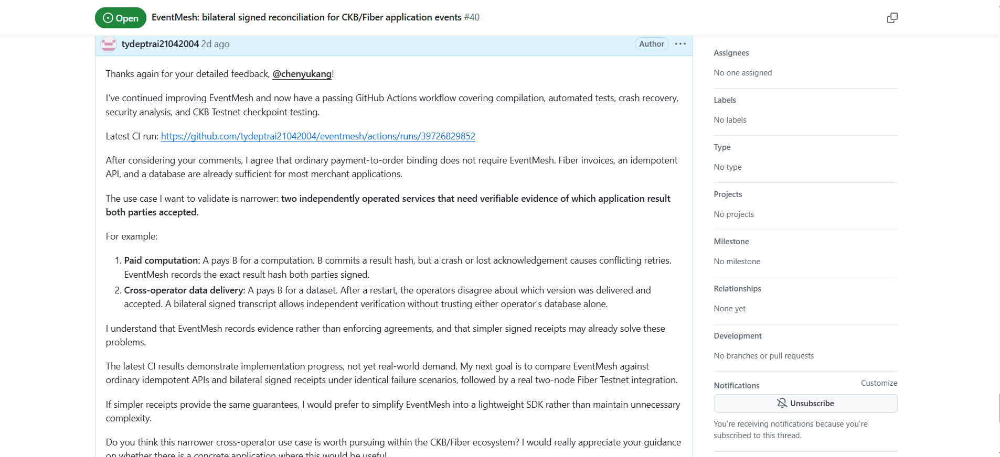

# Week 15 Report — Real-Testnet SkillPass Evidence, Reviewer-Driven Scope Reduction, and Research Follow-through

**Builder:** Dang Ba Ty  
**Track:** Community Keeps Building — Builders  
**Week:** 15  
**Date:** 24 October 2026  
**Reporting period:** 16–24 October 2026  
**Repository:** https://github.com/tydeptrai21042004/ckb-skill  
**Previous report:** [Week 14](./week-14-report.md)

## 1. Summary

This week I focused on validating existing work and acting on CKBuilder technical feedback rather than proposing another product. The clearest milestone was **SkillPass's first reported real CKB Pudge Testnet issue-and-transfer lifecycle**, now supported by a public GitHub Actions run, three transaction identifiers, and author-reported provider checks. In parallel, I updated **EventMesh** in response to `@chenyukang`'s review: the scope is now limited to independently verifiable *application-result* acceptance between operators, not ordinary Fiber payment-to-order binding. EventMesh's latest linked CI run exercises compilation, automated tests, crash recovery, security analysis, and CKB Testnet checkpoint testing, but it does not establish real demand or the proposed independent two-node Fiber workflow.

I also continued to track two reviewer-led engineering boundaries from Week 14. `@jjyr` confirmed that `fiber.stop()` in Fiber JS v0.9.1 is not a sufficient IndexedDB flush guarantee, and referred to upstream shutdown work ([nervosnetwork/fiber#1699](https://github.com/nervosnetwork/fiber/pull/1699)); **FiberContinuity** must therefore avoid claiming a consistent native restore solely from stop/shutdown success. The CellFlow and CellGuard workstreams retain their previously reported safety hardening and evidence requirements; this report does not substitute their automated-test status for independent service-level validation.

Finally, I reconcile a gap in the *weekly reporting* of the **HNDT / CellVG research**. The completed manuscript provided for this report includes the CKB-VM measurements and baseline evaluations previously listed as outstanding in the weekly audit. The missing weekly cross-reference was a reporting omission; the measured experiments were not an uncompleted Week 15 implementation task.

## 2. Week 14 → Week 15 progress and evidence level

| Workstream | Week 14 status / next commitment | Week 15 update | Evidence boundary |
|---|---|---|---|
| **SkillPass** | Retained on-chain Alice → Bob verification still prioritized | **Initial Testnet milestone reported complete.** Public CI run and on-chain identifiers shared in issue #37; 16 verification checks reported as passed | Public run and identifiers supplied in the issue; independent clean-clone reproduction still a separate milestone |
| **SkillPass Care** | Connect Care quotas/history to canonical SkillPass ownership | Protocol/application split retained; real SkillPass lifecycle now gives a concrete upstream integration target | No supplied artifact demonstrates the full Care 3→2→1 sequence against those Testnet transactions |
| **EventMesh** | Validate demand rather than expand scope | Incorporated `@chenyukang`'s critique; linked passing CI with crash/security/CKB checkpoint stages; specified simpler-solution baseline comparison | Screenshot and public CI link support the update; not evidence of independent two-node Fiber settlement or superiority to signed receipts |
| **FiberContinuity** | Full native cold-node recovery and storage flush safety | Upstream maintainer confirmed `fiber.stop()` write-flush limitation; restoration safety scope remains zero-channel and whole-node | No supported complete cold backup → loss → restore → restart result established in these materials |
| **CellFlow** | Retained canonical RPC/live-Cell/SHA evidence bundle | Continued focus on settlement safety and reproducibility from issue #38; prior source/test improvements remain documented | No new complete raw evidence bundle supplied for this report |
| **CellGuard** | Real signed Testnet preflight and historical policy comparison | Previous typed-cell capacity preservation regression remains a concrete safeguard | No new signed-node accepted/rejected acceptance transcript supplied for this report |
| **HNDT / CellVG** | Weekly audit had flagged measured CKB-VM/baseline results as unreported | **Research/reporting reconciliation:** supplied completed Pareto-DPS manuscript contains those measurements and comparisons | Manuscript establishes reported experiments; not a journal acceptance or an independently rerun benchmark in this report |

## 3. SkillPass — first retained CKB Testnet lifecycle

**Project:** https://github.com/tydeptrai21042004/ckb-skill  
**CKBuilder discussion:** https://github.com/Nervos-Community-Catalyst/CKBuilder-projects/issues/37  
**Reported successful workflow:** [GitHub Actions run #39808161770](https://github.com/tydeptrai21042004/ckb-skill/actions/runs/39808161770)

Issue #37 contains my public follow-up stating that the real CKB Pudge Testnet lifecycle ran successfully. The run is described there as **passed in 2 minutes 45 seconds**, with **16 on-chain verification checks passed** and a machine-readable GitHub Actions artifact covering deployment, chain verification, and provider authorization. The author-reported lifecycle includes issuance to Alice, her authorization at Provider A and Provider B, an Alice → Bob transfer, rejection of Alice after transfer, and authorization of Bob at both providers.

| On-chain operation | Transaction hash provided in issue #37 |
|---|---|
| Contract deployment | [`0xb340d171bb9cc0e25e580c406bf2379d8753cddfb38920eade177c896e12a39d`](https://pudge.explorer.nervos.org/transaction/0xb340d171bb9cc0e25e580c406bf2379d8753cddfb38920eade177c896e12a39d) |
| Capability issuance | [`0xbeab784808e46377466605f79be2ea3a0fdeef16e83532d18f735c927025aa25`](https://pudge.explorer.nervos.org/transaction/0xbeab784808e46377466605f79be2ea3a0fdeef16e83532d18f735c927025aa25) |
| Alice → Bob transfer | [`0x223ba748f9bb09c4951e8b0db92f119d1bd046a80d62ece3e33e488d00aafc53`](https://pudge.explorer.nervos.org/transaction/0x223ba748f9bb09c4951e8b0db92f119d1bd046a80d62ece3e33e488d00aafc53) |

This is a material step beyond the simulated workflows described in earlier reports. **The stated completion is the initial author-reported on-chain milestone, not independent external acceptance.** I am keeping clean-clone reproduction, provider process/operator isolation, finality-policy review, and the real canonical ownership bridge into SkillPass Care as separate follow-up tasks. I will not describe SkillPass Care's complete 3→2→1 service-unit journey as having been run against this Testnet lifecycle without the matching retained application logs.

## 4. EventMesh — responding to CKBuilder feedback with a narrower hypothesis

**Project:** https://github.com/tydeptrai21042004/eventmesh  
**CKBuilder issue:** https://github.com/Nervos-Community-Catalyst/CKBuilder-projects/issues/40  
**Latest run cited in my response:** [GitHub Actions run #39726829852](https://github.com/tydeptrai21042004/eventmesh/actions/runs/39726829852)

The most useful challenge from `@chenyukang` was that **Fiber already supports ordinary payment-to-order association**. A merchant can use invoices, `payment_hash`, an idempotent API, and its own database to associate settlement with an order. Building another protocol solely to establish that association would duplicate an existing solution. The reviewer also distinguished Fiber's enforceable channel commitments from EventMesh's signed application transcript: **a jointly signed record is evidence of acknowledgement; it is not an enforcement or dispute-adjudication mechanism**.

I accepted this distinction and narrowed the use case to *two separately operated services that need portable evidence of the exact application result both accepted*, even if their private databases disagree after a lost acknowledgement, crash, or retry. Two candidate cases remain worth testing: (1) paid computation, in which a result hash and client acknowledgement must be tied to the same attempt, and (2) cross-operator data delivery, in which both parties need to determine the dataset version actually accepted after a restart. These are **validation hypotheses, not demonstrated market demand**.

My public response links a **passing GitHub Actions workflow** covering compilation, automated testing, crash recovery, security analysis, and CKB Testnet checkpoint testing. The current test evidence supports implementation progress; it does not by itself establish genuinely independent operator infrastructure, a real receiver-verified two-node Fiber payment, or an advantage over a simpler signed receipt.

### Evidence 1 — review discussion and Week 15 response

The screenshot is a captured public GitHub comment documenting the reviewed problem, my response, the cited CI run, and the proposed comparison with existing approaches. **It is discussion/CI-reference evidence, not a transaction receipt or independent benchmark result.** The public issue and run remain the direct sources for further inspection.

The next EventMesh experiment must use the same failure cases for each alternative:

| Scenario | Plain Fiber invoice + idempotent API + operator DB | Bilateral signed receipt | EventMesh transcript |
|---|---|---|---|
| Lost response after result commitment | Reconcile order/payment state; inspect whether the accepted result is externally provable | Verify exact signed result and its acknowledgement | Verify signed event chain, result commitment, and acknowledgement |
| Duplicate/retried request | Check idempotency-key behavior | Check replay and exact-receipt identity | Check event preconditions, duplicate handling, and fork detection |
| Conflicting result or dataset version after restart | Compare each operator's retained application state | Independently verify both signed statements | Independently verify portable complete transcript and final commitment |
| Divergent operator storage | Determine what unilateral logs can prove | Determine what receipt evidence survives | Determine what additional guarantees, if any, the longer state machine supplies |

The outcome is not pre-decided. If a bilateral signed receipt meets the same evidence and recovery requirements with less complexity, I should simplify EventMesh into a focused SDK rather than retain protocol machinery that does not add a demonstrated guarantee. A genuinely independent two-node Fiber Testnet exercise remains the next integration gate, not something claimed by the screenshot.

## 5. FiberContinuity — adapting to a confirmed upstream shutdown limitation

**Project:** https://github.com/tydeptrai21042004/FiberContinuity  
**CKBuilder issue:** https://github.com/Nervos-Community-Catalyst/CKBuilder-projects/issues/41  
**Upstream follow-up:** https://github.com/nervosnetwork/fiber/pull/1699

My Week 14 report identified the risk of copying IndexedDB after calling `fiber.stop()` while asynchronous database writers might not yet have flushed. In the issue #41 discussion, `@jjyr` directly clarified that **Fiber JS v0.9.1 does not guarantee the required shutdown/flush synchronization**, and pointed to upstream work to wait for shutdown before terminating workers. This matters because a backup must be consistent before its encryption or successful export has any recovery value.

The appropriate implementation boundary stays **cold, complete-node, zero-channel backup and recovery**, with full database isolation and version/network/target checks. Individual-channel recovery and funded-channel safety remain outside the demonstrated scope. I have previously reported hardening of database access guards, whole-node restoration safeguards, and acceptance tests; the materials supplied for Week 15 do not contain a complete successful native cold restore with reproducible post-restart verification. I therefore treat upstream availability and a fresh end-to-end run as an explicit dependency rather than silently marking the recovery milestone closed.

## 6. CellFlow and CellGuard — technical-debt follow-up without overstating evidence

**CellFlow:** https://github.com/tydeptrai21042004/CellFlow — [CKBuilder issue #38](https://github.com/Nervos-Community-Catalyst/CKBuilder-projects/issues/38). Previous weeks documented strengthened separation of chain confirmations from application settlement readiness, expected-Cell checks, reorg-aware monitoring/revocation, RBF/lost-response handling, and webhook durability. Those engineering changes address specific reviewer criticism. What is not independently documented in the Week 15 attachments is the final SHA-bound raw RPC/attempt/webhook/live-Cell bundle needed for an outside service-level reproduction. The existing author-reported Testnet runs should not be conflated with completion of that independent acceptance package.

**CellGuard:** https://github.com/tydeptrai21042004/CellGuard. Last week's new capacity-preservation rule modeled the specific CrowdCell campaign-finalization case raised by Rick, including a synthetic approximately **474 CKB** misallocation regression. This is a useful source-level safeguard, but a synthetic failing fixture is not the same as reproducing a historical signed transaction or proving node preflight behavior against real deployed identifiers. The signed positive/negative Testnet preflight and historical comparison should remain separate, falsifiable checks.

For both projects I am prioritizing reviewer feedback and precise failure boundaries over an unqualified claim that all possible technical debt is eliminated. The new completed SkillPass lifecycle and the EventMesh CI run are independent milestones and do not automatically close these other projects' acceptance gates.

## 7. HNDT / CellVG research — resolving a reporting omission

A previous cross-week audit marked the promised HNDT / CellVG CKB-VM benchmarking and baseline comparisons as missing from subsequent *weekly reports*. The completed manuscript supplied alongside this Week 15 report, **“Pareto-Optimal Cost-Aware Dispute Policies for Optimistic Verifiable Computation,”** provides those results; I should have linked this separate academic workstream back to the engineering reports sooner.

The manuscript implements **Pareto-DPS** in **CellVG** and evaluates **126 directly measured CKB-VM intervals**, from **three deterministic traces of 12 transitions each**. Its experimental discussion and comparison tables cover midpoint/pinpoint localization, adaptive splitting/stopping configurations, and scalar minimax DPS. The reported Pareto-DPS improvement among minimax-optimal policies is **16.64%–22.07% lower expected dispute cost**, while the comparison with midpoint/pinpoint-style localization reports **1.60%–8.67% lower worst-case cost** across the traces. These are results reported in the supplied manuscript, not fresh measurements rerun as part of preparing this GitHub report.

| Audit item | Week 15 reconciliation |
|---|---|
| Measured CKB-VM interval costs | **Documented in completed research manuscript** (126 measured intervals) |
| Fixed-midpoint/pinpoint and other baseline comparisons | **Documented in manuscript's experimental section and Tables 4–5** |
| Worst-case and expected-cost comparisons | **Documented** with the above manuscript results |
| Missing next-week report reference | **Closed as a reporting omission**, by this section |
| Independent benchmark reproduction / journal decision | Not claimed here; keep separate from completion of the paper's reported experiments |

Week 13 separately recorded submission to *Science of Computer Programming* under manuscript number `SCICO-D-26-00766`. Submission acknowledgement is not acceptance. The supplied updated manuscript uses a different title from that recorded submission; this report does not presume editorial metadata was changed unless confirmed by the journal. The PDF itself is **not republished in this GitHub patch**, to avoid unintentionally distributing an editorial manuscript; it was used to check the research summary.

## 8. Evidence inventory and milestone status

| Artifact | Supports | Does not establish |
|---|---|---|
| [SkillPass CI #39808161770](https://github.com/tydeptrai21042004/ckb-skill/actions/runs/39808161770), issue [#37](https://github.com/Nervos-Community-Catalyst/CKBuilder-projects/issues/37), and three tx hashes above | Public author-reported Pudge Testnet deployment / issue / transfer lifecycle and 16 checks | Independent provider clean-clone replication or complete Care service-unit sequence |
| [EventMesh CI #39726829852](https://github.com/tydeptrai21042004/eventmesh/actions/runs/39726829852) | Cited passing workflow covering tests, recovery, security analysis, and checkpoint tests | Real two-node Fiber payment or superiority to normal receipts |
| [EventMesh reviewer screenshot](./evidence/week-15-eventmesh-review-response.png) | Public feedback, response, narrower problem statement, CI link | Chain settlement, business adoption, reviewer endorsement |
| [FiberContinuity #41](https://github.com/Nervos-Community-Catalyst/CKBuilder-projects/issues/41) and [upstream #1699](https://github.com/nervosnetwork/fiber/pull/1699) | Confirmed shutdown/flush-safety issue and upstream follow-up | Passing native cold restore or funded-channel safety |
| Week 14 source/regression reporting for CellFlow and CellGuard | Status of previously documented technical hardening | Newly completed independent service-level Testnet evidence |
| Supplied Pareto-DPS research PDF | Completed manuscript's measurements and baseline results | A new Week 15 benchmark run, journal acceptance, or production integration |

**Evidence status:** The SkillPass live-Testnet milestone is supported by publicly cited author-reported CI and transaction references. The EventMesh screenshot is included as the requested new local evidence asset. Independent reproduction, service-level external validation, and cross-project integrations remain distinguishable from passing automation.

## 9. Next work — small, testable milestones

1. **SkillPass / Care:** request one independent clone of the public Testnet lifecycle; retain provider isolation details and prove Care quota/history continuity against the canonical live-owner transition rather than merely against a demo owner adapter.
2. **EventMesh:** run the same fault matrix for a standard Fiber invoice/idempotent API, a bilateral signed receipt, and the full transcript; publish deterministic inputs, crash/retry logs, verification results, and complexity comparison. Proceed to independent two-node Fiber Testnet integration only where it demonstrates an actual additional requirement.
3. **FiberContinuity:** track the supported upstream shutdown fix, validate flush/isolation semantics, then repeat a **zero-channel full-node** cold backup → simulated loss → restore → restart → verification with sanitized browser/CI evidence. Continue to prohibit funded-channel restoration claims.
4. **CellFlow / CellGuard:** attach clean reproducibility artifacts to existing reviewer threads instead of creating additional features: SHA-tied RPC and settlement records for CellFlow, and signed-node preflight/historical policy evidence for CellGuard.
5. **Research reporting:** cross-link the completed HNDT / CellVG manuscript results in future progress summaries and keep journal decisions separate from measurement claims.

## 10. Closing reflection

This week's strongest technical progress was the transition from a SkillPass local lifecycle demonstration to an author-reported real Testnet deployment, issuance, and transfer with published transaction identifiers. Equally important was **accepting critical feedback that narrowed EventMesh's purpose**. The next question is not whether the project can support a larger signed state machine, but whether that machinery offers a testable benefit over Fiber's native payment evidence plus ordinary application controls and simple signed receipts.

The FiberContinuity upstream response illustrates why the difference between *tests passing* and *the required safety property being established* matters. I will continue to make that difference explicit in weekly reporting and use reproducible evidence to decide which project milestones are actually complete.

---

*Evidence note: This report uses the supplied CKBuilder issue text, Week 14 source report, EventMesh screenshot, and supplied Pareto-DPS research manuscript. Claims concerning external CI runs and chain transactions are reproduced from linked public author reports, not independently rerun while preparing this report. No new transaction hashes, test results, funding decisions, editorial acceptance, or native Fiber recovery records have been invented.*
