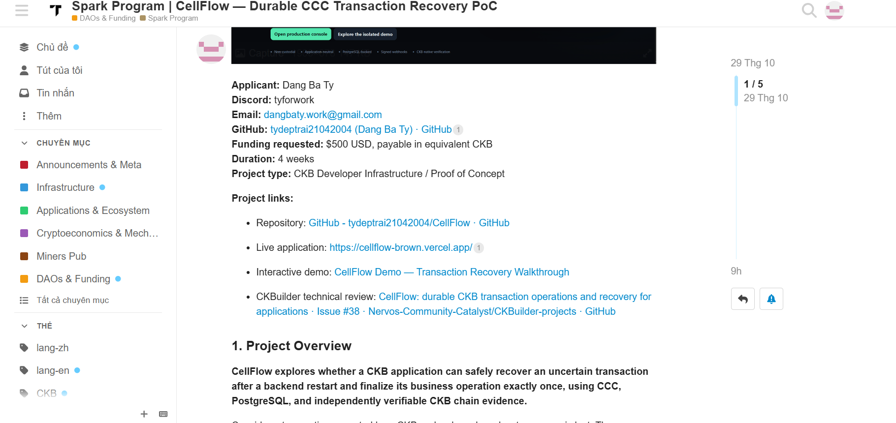

# Week 16 Report — Final CKBuilder Review Submission, CellGuard Testnet Audit, and First Spark Grant Proposal

**Builder:** Dang Ba Ty  
**Track:** Community Keeps Building — Builders  
**Week:** 16  
**Date:** 31 October 2026  
**Reporting period:** 25–31 October 2026  
**Repository:** https://github.com/tydeptrai21042004/ckb-skill  
**Previous report:** [Week 15](./week-15-report.md)

## 1. Summary

This week marked a transition from technical implementation within CKBuilder toward final project review and a focused proposal for further development. I submitted **CellGuard** to the CKBuilder project-review process in [issue #48](https://github.com/Nervos-Community-Catalyst/CKBuilder-projects/issues/48), presenting the browser-based CKB transaction policy inspector, its matching Node.js CLI, automated checks, and a reported successful historical CKB Testnet audit. `@chenyukang` welcomed the project and identified `@Xcodes-chain` as its mentor; technical review and follow-up remain open.

I also submitted my **first Spark Grant application**, [CellFlow — Durable CCC Transaction Recovery PoC](https://talk.nervos.org/t/spark-program-cellflow-durable-ccc-transaction-recovery-poc/11067), requesting **$500 equivalent in CKB over four weeks**. Following Neon's guidance, the proposal concentrates on an end-to-end CCC reference application with PostgreSQL persistence, controlled lost-response and restart recovery, real Testnet verification, and idempotent business finalization. It specifically separates existing CellFlow capabilities from the new integration and validation work proposed for funding. The application has been submitted, not approved.

Together, these steps form my final CKBuilder reporting focus: making completed work available for review, documenting the evidence behind its claims, and choosing one technically grounded direction to pursue beyond the program.

## 2. Week 15 → Week 16 progress

| Workstream | Week 15 position | Week 16 development | Current status |
|---|---|---|---|
| **CellGuard** | Typed-Cell capacity-preservation regression and outstanding real-chain evidence | Submitted [CKBuilder issue #48](https://github.com/Nervos-Community-Catalyst/CKBuilder-projects/issues/48), including a successful historical Testnet audit and public workflow link | Public review opened; mentor identified; application-specific real-deployment policies remain future work |
| **CellFlow** | Reviewer-driven recovery and settlement hardening; independent application integration not yet complete | Submitted first [$500 Spark proposal](https://talk.nervos.org/t/spark-program-cellflow-durable-ccc-transaction-recovery-poc/11067) | Funding decision pending; proposed CCC reference PoC not presented as completed |
| **CKBuilder final review** | Consolidate reproducible evidence and reviewer feedback | Presented CellGuard as a reviewable final-stage developer tool and summarized the direction for further work | Submitted for review, not independently accepted or certified |
| **Other Week 15 projects** | SkillPass real Testnet lifecycle; EventMesh CI and narrowed scope; FiberContinuity upstream dependency; CellVG research documentation | No additional completed milestones claimed in this report | Previous evidence and outstanding acceptance gates remain as reported in Week 15 |

## 3. CellGuard — final project submission for CKBuilder review

**Repository:** https://github.com/tydeptrai21042004/CellGuard  
**Hosted inspector:** https://cellasagfas.vercel.app/  
**Review issue:** https://github.com/Nervos-Community-Catalyst/CKBuilder-projects/issues/48  
**Historical audit workflow:** https://github.com/tydeptrai21042004/CellGuard/actions/runs/40646674710

CellGuard is an open-source transaction policy inspector for CKB builders. It examines a transaction's Cells, capacities, script identities, recipients, dependencies, `since` constraints, and application-defined invariants before signing or submission. It provides an interactive browser interface, a Node.js CLI, and GitHub Actions checks suitable for reproducible policy regression testing.

The strict-v3 policy implementation includes role-based capacity accounting, exact script-based allowlists, controlled net-gain rules, dependency and `since` checks, and optional typed-Cell capacity preservation. Read-only CKB RPC workflows can resolve historical inputs and inspect transaction fees and chain evidence. The inspector does not sign or broadcast transactions, and its policy verdict is not a consensus or smart-contract security proof.

My CKBuilder submission also clearly identifies the main unfinished problem: translating synthetic policy regressions and public simple-transaction audits into reviewed, application-specific policies for deployed CKB contracts. This is a useful direction for mentor feedback because a policy's value depends not just on its execution, but also on whether its script identities and invariants faithfully represent the application being protected.

### Historical CKB Testnet audit evidence

The submitted [GitHub Actions run](https://github.com/tydeptrai21042004/CellGuard/actions/runs/40646674710) was reported successful. The issue includes structured and textual evidence transcribed from the workflow log for a read-only historical audit of a public Testnet consolidation transaction.

| Evidence field | Reported result |
|---|---|
| Historical policy outcome | `MATCH` |
| Input source | `rpc-historical` |
| Resolved inputs | 3 |
| Outputs | 1 |
| Total input capacity | 268.99998322 CKB |
| Total output capacity | 268.99996812 CKB |
| Transaction fee | 0.00001510 CKB |
| Accounting provenance | `role-level-accounting-not-coin-tracing` |
| Protected typed Cells in audited transaction | None (`[]`) |
| Workflow report SHA-256 | `aba9db11dc3aea8f5a3372d9008200d96e31953ef90cb3c1e0b765558a210b90` |

The public transaction hash referenced in the audit setup was `0x6fb7350b37463df3e31fcfd5558651193fb8ff5dd3c824e0b1afe31892b90448`. The issue notes that the hash was not explicitly printed in the provided job-log excerpt. The successful audit demonstrates read-only historical input resolution and a policy match for the tested transaction; it does **not** establish typed-Cell contract protection, demonstrate a live exploit, or validate an independently reviewed security policy for a production dApp.

### Community review

`@chenyukang` responded to the CellGuard submission and indicated that `@Xcodes-chain` would serve as mentor, with follow-up discussion available in the issue. I requested feedback on pre-signing policy usefulness, exact script identity, typed-Cell capacity preservation, role-level accounting, RPC trust boundaries, and the browser/CLI/CI developer experience.

The next meaningful test is to apply a reviewed policy to a real deployed CKB application's transaction pattern, retain the exact script identifiers and policy version, and compare local verdicts against independently inspectable evidence. This remains future validation work rather than a completed Week 16 result.

## 4. CellFlow — first Spark Grant proposal submitted

**Spark proposal:** https://talk.nervos.org/t/spark-program-cellflow-durable-ccc-transaction-recovery-poc/11067  
**Repository:** https://github.com/tydeptrai21042004/CellFlow  
**Live application:** https://cellflow-brown.vercel.app/  
**Prior CKBuilder review:** https://github.com/Nervos-Community-Catalyst/CKBuilder-projects/issues/38

After discussing grant readiness with Neon, I selected CellFlow as my most viable project for a small proposal. CellFlow has received substantial CKBuilder technical feedback on uncertain broadcasts, replacement transactions, input conflicts, confirmation policies, expected output Cells, settlement assertions, and reproducible verification. Neon's recommendation was to pursue a **small Spark PoC**, potentially integrated into a real CCC workflow, instead of broadening an already extensive backend.

I followed that recommendation and submitted the proposal on **29 October 2026**. The requested funding is **$500 USD equivalent in CKB**, with a four-week delivery period. The objective is not to fund already implemented transaction recovery machinery. It is to demonstrate that another CKB developer can integrate CellFlow into a small CCC application and observe correct recovery and settlement behavior under controlled failures.

### Evidence 1 — public Spark proposal submission

*Figure 1. Screenshot of the CellFlow Spark Program proposal on Nervos Talk, dated 29 October 2026. The screenshot identifies the public application, applicant, funding request, duration, and links to the project. It documents the proposal's submission, not a Spark Committee decision or completed funded deliverables. See the [public proposal thread](https://talk.nervos.org/t/spark-program-cellflow-durable-ccc-transaction-recovery-poc/11067) for the full application.*

### Proposed CCC reference workflow

The funded experiment would connect a CCC-compatible wallet, prepare and sign a real CKB Testnet transaction, durably record its identity and related business intent in PostgreSQL, then broadcast it. In a controlled test, the successful RPC broadcast response would be discarded and the application worker restarted. CellFlow would recover the stored attempt, reconcile it against canonical chain state, validate the configured confirmation policy and required Cell assertions, and emit `intent.settlement_ready` only when those conditions are satisfied. The reference application would then finalize the business operation idempotently, including under duplicate event delivery.

The proposal maintains separate responsibilities: CCC handles wallet signing, CKB provides authoritative transaction and Cell observations, CellFlow preserves operational reconciliation state, and the example application owns the business effect. Reproducible tests and public Testnet evidence are planned as deliverables, rather than being represented as already completed outputs of the Spark project.

### Proposed milestones and funding

| Milestone | Timeline | Planned deliverable |
|---|---|---|
| **M1 — CCC and PostgreSQL integration** | Week 1 | Minimal reference application and durable transaction records |
| **M2 — Testnet recovery and settlement** | Weeks 2–3 | Real transaction workflow, lost-response injection, worker restart, and idempotent finalization |
| **M3 — Independent validation** | Week 4 | Reproduction guide, Testnet evidence, demo, and external developer feedback |

| Work package | Proposed budget |
|---|---:|
| CCC reference application and integration | $175 |
| PostgreSQL setup and restart-safe persistence | $125 |
| Testnet recovery and settlement validation | $150 |
| Documentation, demo, and developer testing | $50 |
| **Total requested** | **$500** |

This is an **application under review**, not a funding award or a claim that these new deliverables have been completed. I also confirmed with Neon that Spark applications should be pursued **one at a time**, so CellFlow is my current grant focus rather than submitting multiple parallel proposals.

## 5. Feedback and direction beyond CKBuilder

Neon's feedback helped turn a broad collection of CKB experiments into a clearer development priority. He suggested Spark as a possible route for a small proposal, while noting that the committee would determine whether the scope fits the program. His recommendation was to present an identifiable PoC and demo built upon a new integration foundation. This directly shaped the CellFlow proposal's distinction between existing recovery functionality and the funded CCC demonstration.

The CellGuard review follows a parallel but separate path. It is a public request for technical assessment, not a second grant application. The mentor assignment gives the tool a concrete feedback channel for testing whether its proposed transaction policies correspond to actual CKB application requirements.

I also asked whether I could continue sharing and developing open-source projects after CKBuilder concludes. Neon confirmed that I can remain involved as a **CKBuilder alumnus**. I intend to keep the existing repositories available, respond to reviewer feedback, and contribute to the CKB/Fiber ecosystem beyond this reporting period.

## 6. Evidence and submission status

| Public artifact | What it supports | Current boundary |
|---|---|---|
| [CellGuard CKBuilder issue #48](https://github.com/Nervos-Community-Catalyst/CKBuilder-projects/issues/48) | Final-stage technical review submission and mentor response | Review has begun; no final independent acceptance claimed |
| [CellGuard historical audit run](https://github.com/tydeptrai21042004/CellGuard/actions/runs/40646674710) | Reported successful read-only historical Testnet audit | The inspected transaction has no protected typed Cells; does not prove contract security |
| [CellGuard repository](https://github.com/tydeptrai21042004/CellGuard) and [hosted interface](https://cellasagfas.vercel.app/) | Public implementation and developer-facing inspection interface | Usability and real-world policy completeness remain review questions |
| [CellFlow Spark proposal](https://talk.nervos.org/t/spark-program-cellflow-durable-ccc-transaction-recovery-poc/11067) | Publicly submitted $500 / four-week grant application and defined milestones | No grant approval or funded PoC delivery claimed |
| [Week 16 Spark submission screenshot](./evidence/week-16-cellflow-spark-proposal-submission.png) | Captured public proposal title, applicant, funding request, and planned duration on Nervos Talk | The screenshot does not verify a funding decision or new on-chain test results |
| [CellFlow review issue #38](https://github.com/Nervos-Community-Catalyst/CKBuilder-projects/issues/38) | Earlier reviewer discussion and recovery-safety corrections | Independent reference-integration results are planned in the Spark scope |
| [Week 15 report](./week-15-report.md) | Prior SkillPass, EventMesh, FiberContinuity, and research milestones | No new Week 16 test completion inferred for those workstreams |

## 7. Next steps

1. **CellGuard:** respond to `@Xcodes-chain`'s technical review and select one real CKB application transaction pattern for a reviewed, reproducible policy test.
2. **CellFlow Spark:** follow the committee's review process, clarify scope if requested, and preserve the distinction between existing software and proposed funded work. Begin funded-milestone reporting only if the application proceeds.
3. **Reproducibility:** keep public workflow links, source revisions, exact transaction identifiers, and relevant policy or database artifacts together so technical reviewers can evaluate claims without relying on screenshots alone.
4. **CKBuilder follow-through:** keep remaining project acceptance gates visible, especially independent Testnet reproduction and the upstream Fiber shutdown-safety dependency, rather than treating the end of the reporting cycle as completion of every technical task.

## 8. Closing reflection

Week 16 represents a shift in my CKBuilder work from developing multiple experiments to presenting specific, reviewable outcomes and selecting a practical next step. CellGuard now has a public final-stage review thread, an assigned mentor, and a historical Testnet audit that makes its present capabilities easier to evaluate. CellFlow has become my first formal grant proposal, with a small budget, explicit CCC integration milestones, and measurable recovery and settlement requirements.

I am grateful to Neon and the CKBuilder mentors and community developers for their guidance throughout the program, particularly for the critiques that helped me improve technical correctness and narrow project scope. Becoming a CKBuilder alumnus is not the end of this work. I hope to continue contributing open-source tools that other CKB developers can inspect, reproduce, and eventually use in their own applications.
